### COMPUTER SCIENCE STUDENT · BACKEND DEVELOPMENT · AI ENGINEERING

*Learning deeply. Building consistently. Engineering better.*

---

## ☀️ The Sun — About the builder

Hey, I'm **Sri Naren** — a Computer Science Engineering student exploring the intersection of software engineering and artificial intelligence.

I like understanding how systems work beneath the surface: from programming fundamentals and data structures to APIs, backend services, and AI-powered applications.

- 🔭 Currently exploring **Python, Java, backend engineering and Agentic AI**.
- 🧠 Learning **LLMs, tool calling, multi-agent workflows and practical AI development**.
- 🛠️ Building projects that connect software with real-world problems.
- ☁️ Exploring **AWS and cloud fundamentals**.
- 🎯 Long-term direction: become a strong software engineer with the ability to build intelligent systems.

> I value fundamentals, practical experimentation, and software that solves real problems.

---

## 🪐 The planetary system — My technology orbit

| Planet | Technology orbit | Current focus |
|---|---|---|
| 🔵 Earth | Python | Backend development, APIs and AI experiments |
| 🟠 Mercury | Java | OOP, problem solving and DSA foundations |
| 🟣 Neptune | LLMs & Agentic AI | Prompting, tool calling and agent workflows |
| 🔴 Mars | React & JavaScript | Building useful application interfaces |
| 🟡 Jupiter | AWS & Cloud | Cloud fundamentals and core services |
| 🪐 Saturn | SQL & Databases | Data modelling and database fundamentals |

*This is a learning-interest map, not a claim of expert-level proficiency.*

---

## 🚀 Missions — Selected projects

### 🌾 CropShield AI
An agricultural intelligence project focused on crop disease detection, farmer guidance and crop-health support, with a South Indian farming context.

- Focus: AI-assisted crop analysis and practical farmer-facing workflows.
- Live project: [cropshieldcc.vercel.app](https://cropshieldcc.vercel.app/)
- Technologies: React, Python, AI/ML and cloud-backed application services.

### 🛡️ SAFENET
A digital-risk protection concept focused on discovering suspicious profiles, impersonation signals and potentially fraudulent digital activity.

- Focus: digital trust, investigation workflows and real-world data sources.
- Technologies: React, APIs and Supabase.

### 🧭 NER-LogiAI
A smart logistics and accessibility intelligence concept for evaluating route resilience and highlighting vulnerable route segments.

- Focus: route comparison, accessibility and explainable risk signals.
- Technologies: React, Python and Supabase.

---

## 🧰 Mission control — Tools & technologies

**Languages**

**Backend, data & frontend**

**Cloud & developer tools**

---

## 📡 Signals from GitHub

Statistics are loaded from third-party services and may be unavailable or rate-limited. They are not hardcoded.

---

## 🌌 Beyond the orbit — What I'm working toward

- Strengthening Java, Python, OOP and DSA fundamentals.
- Building backend services with Python and FastAPI.
- Understanding LLM internals and designing useful AI agents.
- Learning databases, system design and cloud deployment.
- Shipping projects with clear documentation and maintainable code.

---

## 📬 Establish contact

If you're interested in building, learning, hackathons or practical AI projects, let's connect.

**Keep exploring. Keep building.**

Designed as a small universe of what I'm learning and building.

